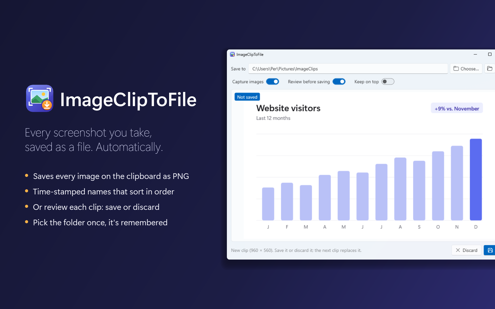

# ImageClipToFile

[](https://github.com/kreaton/ImageClipToFile/releases/latest)
[](LICENSE)




**Take screenshots and have each one saved as a file automatically.**

ImageClipToFile watches the Windows clipboard. When an image arrives (from Win+Shift+S, Print Screen, the Snipping Tool, "Copy image" in a browser, or any other app), it is saved as a PNG in a folder you choose. No pasting, no Save dialog.

## Install

**[Download the installer](https://github.com/kreaton/ImageClipToFile/releases/latest/download/ImageClipToFile-win-Setup.exe)** and run it. If your PC doesn't have the .NET 10 Desktop Runtime yet, the installer adds it.

The installer isn't code-signed, so Windows may warn you about it. To continue, choose **More info → Run anyway**.

To get a newer version later, click the **ⓘ** button (or press F1) and choose **Check for updates**. To remove the app, use **Settings → Apps → Installed apps** in Windows.

## How to use it

1. Start ImageClipToFile.
2. Click **Choose…** and pick the folder the images should go in. The default is `Pictures\ImageClips`. The folder is created if it doesn't exist, and the app remembers your choice.
3. Take screenshots as usual, for example with **Win+Shift+S** or **Print Screen**. Each image is saved straight away and shown in the window.
4. Click the folder button (or press **Ctrl+O**) to open the folder in File Explorer.

Files are named after the moment they were captured, so they sort in the order you took them:

```
imageclip_20261108_164756_174.png
          yyyyMMdd_HHmmss_fff
```

### Review before saving

Turn on **Review before saving** if you only want to keep some of your clips. Each new image is then shown with a **Not saved** badge, and you decide:

- **Save** (Ctrl+S) writes it to the folder.
- **Discard** (Esc or Delete) throws it away.
- Do nothing, and the next image you copy simply replaces it. The old one is never saved.

If you close the app while a clip is waiting, it asks whether to save it first.

### Switches

| Switch | What it does | Shortcut |
| --- | --- | --- |
| Capture images | Listen for images on the clipboard. Turn it off to copy images without saving them. | Ctrl+Shift+A |
| Review before saving | Show each image and let you save or discard it, instead of saving automatically. | Ctrl+Shift+R |
| Keep on top | Keep the window above other windows, handy while reviewing. | Ctrl+Shift+T |

## Good to know

- Only images are captured. Copying text or files is ignored.
- Images are always saved as PNG, so nothing is lost to compression. Transparent images stay transparent.
- If an app announces the same image several times in a row, it is only saved once.
- The title bar shows how many clips you have saved in this session.
- The app follows the Windows light or dark setting.
- Your folder, switches and window position are remembered in `%LocalAppData%\ImageClipToFile\settings.json`.
- The version, build time and commit are shown under **ⓘ** (F1).

---

## For developers

The app is built with WPF on .NET 10, using the built-in Fluent theme. Installs and updates use [Velopack](https://velopack.io).

Build and run it with the .NET 10 SDK:

```bash
dotnet run --project ImageClipToFile/ImageClipToFile.csproj
```

Or open `ImageClipToFile.slnx` in Visual Studio 2026.

### How it works

- `MainWindow` registers for `WM_CLIPBOARDUPDATE` with `AddClipboardFormatListener`, so it is told about every clipboard change without polling. The clipboard is read after the message has been handled, once per burst of updates.
- `ClipboardImage` reads the image. WPF's `Clipboard.GetImage()` turns many screenshots black or transparent, so it tries the `PNG` format first, then decodes `CF_DIB` itself by adding the missing BMP file header. A 32-bit bitmap whose alpha channel is all zero (common for screenshots) is treated as opaque.
- Each image is encoded as PNG once. Its SHA-256 hash is used to skip repeats within two seconds; the same bytes are written to disk, or held while you review the clip.
- `AppSettings` loads and saves the JSON settings file.

### Releases

Every push to `main` runs [.github/workflows/release.yml](.github/workflows/release.yml), which calls [BuildRelease.ps1](ImageClipToFile/BuildRelease.ps1). The script publishes a framework-dependent win-x64 build, packs it with Velopack's `vpk`, and uploads it as a GitHub release with the installer and delta packages.

- The version is `Major.Minor.Patch`. Set Major.Minor by hand in [Directory.Build.props](Directory.Build.props). The patch is one higher than the latest release with that Major.Minor.
- Pushes that only touch docs can skip a release with `[skip ci]` in the commit message.
- To build an installer locally without uploading anything:

  ```bash
  dotnet tool install -g vpk --version 1.2.161
  ```

  ```bash
  pwsh ImageClipToFile/BuildRelease.ps1 -LocalOnly
  ```

  The installer ends up in `ImageClipToFile/Releases`.

## Credits

- Made by Per Hejndorf.
- Installer and updates by [Velopack](https://velopack.io) (MIT).
- Interface icons from Segoe Fluent Icons, which ships with Windows.
- Built with help from [Claude Code](https://claude.com/claude-code).

## License

[MIT](LICENSE) © 2026 Per Hejndorf
